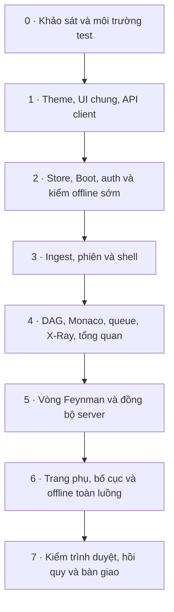

# KẾ HOẠCH TRIỂN KHAI FRONTEND SIMPLIFEY

> Yêu cầu hành vi: [YEU_CAU_FRONTEND.md](./YEU_CAU_FRONTEND.md) (YC-01–YC-18). Danh mục task và bằng chứng: [TIEN_DO.md](./TIEN_DO.md), agent cập nhật sau kiểm tra, không có cơ chế tự động đồng bộ.
> Nguồn chuẩn: [spec/00](../../../docs/spec/00_QUYET_DINH.md), [spec/01](../../../docs/spec/01_KIEN_TRUC_VA_LUONG.md), [spec/02](../../../docs/spec/02_CONTRACTS.md), [spec/03](../../../docs/spec/03_API_VA_LUU_TRU.md), [spec/30](../../../docs/spec/30_UI.md), [spec/50](../../../docs/spec/50_TEST_VA_FIXTURE.md). Phiếu tham chiếu: [vai D](../../../docs/quy-trinh-code-21h/vai-D/README.md). Spec thắng khi khác tài liệu này hoặc Taste Skill.

## 1. Phạm vi, nền hiện có và giới hạn sửa

Đây là kế hoạch code sau khi tài liệu được chốt, không phải báo cáo code đã đạt. Lần chỉnh tài liệu chỉ sửa bộ tài liệu web; không thay backend, API, contracts hoặc quyết định sản phẩm. Không thêm endpoint/type public, radar năm trục hoặc PWA. BKT là mô hình kỹ năng, không phải DAG bài học.

### 1.1. Nền quan sát khi soạn kế hoạch

| Hạng mục (đường dẫn từ gốc repo) | Cách xử lý khi implement |
| :-- | :-- |
| `src/lib/api.ts` | Sửa thích nghi có giới hạn: UI mới dùng các hàm …Safe hiện có; giữ chữ ký apiFetch và API cũ để không phá caller/test |
| `src/lib/messages.ts`, `src/lib/similarity.ts` | Tái sử dụng; chỉ sửa nếu đối chiếu spec phát hiện thiếu/sai, không thay thuật toán/ngưỡng |
| `src/store/workbench.ts` | Sửa thích nghi: đã có queue, open/load/reload run; bổ sung lifecycle/apply response, không viết lại từ đầu |
| `src/lib/offline.ts` | Tái sử dụng runtime, sửa thích nghi dispatch và chuyển chế độ nếu cần; không làm engine offline thứ hai |
| `src/lib/overview-view.ts` | Tái sử dụng facts/discovered helpers; kiểm bundle client, không kéo module có side effect server vào client |
| `src/lib/{bkt-engine,plan,derive}.ts` | Hàm dùng chung: chỉ đọc/tái sử dụng, không sửa công thức vì nhu cầu UI |
| `src/lib/supabase/client.ts`, `src/app/auth/callback/route.ts` | Tái sử dụng OAuth/cookie/PKCE/next an toàn, không viết lại callback |
| `src/stores/userStore.ts` | Code cũ còn tồn tại; UI mới không dùng làm bản sao profile/token cạnh tranh, không xóa trong đợt này |
| Pages, components, assets UI | Working tree có các file bị xóa sẵn; tạo mới file được giao, không checkout/restore hàng loạt để lấy lại UI cũ |
| `public/demo/mock_bundle.json` và tests hiện có | Đọc và kiểm chứng; không tự sửa đáp án ghi lại để test xanh |
| `vitest.config.ts` | Hiện môi trường node, chỉ nhận test.ts; bổ sung DOM/test.tsx ở task 0.2, giữ test backend chạy node |

Các quan sát trên phải kiểm lại ở task 0.1. Việc có file/test không chứng minh chức năng đã đạt. Không đọc archive, .env* hoặc worktree cũ để tìm đường tắt; .kb/README.md đọc nếu có, nếu thiếu ghi nhận và dùng hướng dẫn repo hiện hành.

### 1.2. Allowlist triển khai

Mỗi task chỉ sửa tập con của allowlist sau; đường dẫn tính từ gốc repo:

- Pages: `src/app/layout.tsx`, `globals.css`, `page.tsx`, các `page.tsx` dưới login/register/learn/roadmap/history/report/how-it-works; không cho phép toàn bộ app/**.
- Components trong `src/components/{layout,home,canvas,code,learn,ui}/`; các component riêng trang phụ nằm trong nhóm tương ứng hoặc trong page được giao.
- State: `src/store/workbench.ts`, `src/store/theme.ts`, `src/store/layout.ts`; hằng layout nội bộ `src/components/learn/layout.ts`.
- Helper client: `src/lib/api.ts`, `messages.ts`, `similarity.ts`, `offline.ts`, `overview-view.ts`, `theme-script.ts`. Chỉ sửa nhu cầu task, không coi toàn bộ lib/** là vùng frontend.
- Test cho các file trên: `src/lib/__tests__/`, `src/store/__tests__/`, `src/components/**/__tests__/`, test tích hợp UI tại `src/__tests__/frontend/`.
- Ngoại lệ test ở task 0.2: `package.json`, `package-lock.json`, `vitest.config.ts`, `src/__tests__/frontend/setup.ts` để thêm môi trường DOM/component; không nâng phiên bản stack hoặc thay dependency khác.
- Asset mới có dùng thực tế tại `public/frontend/`; không chỉnh asset/grammar/bundle hiện có. Bộ tài liệu `src/app/web/*.md` chỉ cập nhật task/bằng chứng liên quan.

Blocklist: `src/server/**`, `src/app/api/**`, `src/app/auth/**`, `src/contracts/**`, migration, queries, grammar, bundle đã duyệt và các hàm dùng chung đã nêu. Thiếu contract ghi rõ vấn đề cho vai A, không bịa tên/giá trị. Không bypass auth; offline là nhánh demo theo spec, không ngoại lệ cho request server. Không tự commit, push, tạo worktree hoặc phục hồi thay đổi người dùng.

### 1.3. Quy ước kỹ thuật

- UI gọi hàm …Safe, kiểm ApiResult.ok; ApiError dùng error.message. Giữ tương thích apiFetch đang throw ApiClientError; không đổi tất cả caller để đạt một cách viết tài liệu mới.
- Workbench sở hữu dữ liệu phiên và profile/clock offset của UI mới; theme/layout riêng. UserStore cũ không được import vào UI mới để lưu lại profile/token. Không thêm schema API/DB.
- Slice UI theo spec/30 Mục 7.1; khi tên hiện có khác (`skill_changes`, `presentation_pane`), task 2.1 chuyển caller của UI mới và test liên quan sang tên đã chọn trong spec, không nhân đôi hai state cùng ý nghĩa.
- Side effect đi qua action/helper của luồng, component đọc selector. Mọi request có ngữ cảnh phiên/chế độ/thế hệ và kiểm trước áp response; không dùng session_id đơn lẻ để phân biệt lần mở lại cùng phiên.
- Taste Skill chỉ hỗ trợ khi không xung đột spec: giữ font, màu, bố cục cockpit theo spec/30; không tự đổi violet/accent hoặc ép khung trang quảng cáo. Accessibility và khả năng đọc quan trọng hơn hiệu ứng trang trí.
- Số vận hành import CONFIG; layout mặc định/giới hạn nội bộ theo ngoại lệ spec/30. Kỳ vọng định lượng của test lấy nguyên từ spec/50, không chép thành cấu hình mới.

## 2. Thứ tự và mốc tích hợp

- Mốc A sau 4.2: bản đồ + code đọc được từ fixture, số dòng gốc đúng.
- Mốc B sau 4.4: ingest thật → chọn node → X-Ray thật; queue đúng D-46, tổng quan facts sớm.
- Mốc C sau 5.3: enrich → trả lời/gợi ý → reveal/báo sai → profile/progress từ server → tải lại phiên.
- Mốc D sau 6.3: resume và offline chạy kịch bản, trang phụ/bố cục hoàn chỉnh.
- Mốc E sau 7.3: đủ bằng chứng kiểm tự động và browser; người dùng kiểm trước commit.

Lịch và thứ tự cắt theo [kế hoạch 21 giờ Mục 2–3](../../../docs/doc-de-hieu/07_ke_hoach_21h.md), không ấn định một lịch thi mới ở đây. Nếu đủ điều kiện cắt, giữ thứ tự của nguồn: phần engine đã cắt theo D-76/tải chọn lọc thuộc vai khác → Báo sai → Lịch sử → phần AI Tổng quan. Vai frontend chỉ áp dụng mục đã quyết định, ẩn nút và ghi nhận theo quy trình đó; không cắt DAG tất định, X-Ray, câu hỏi/chấm/gợi ý, BKT server, offline hoặc guardrail. Radar/PWA không nằm trong scope nên không phải tính năng đem cắt khi trễ.

## 3. Danh mục task

Mỗi task dưới đây có phụ thuộc, đầu vào, phạm vi, đầu ra và tiêu chí. “Đạt” cần test/bằng chứng được chỉ định; test tích hợp cần backend sẽ chạy tại mốc tích hợp/7.2, không giả báo đã chạy lúc component mới dựng. Số lượng task lấy từ danh mục này và phải khớp TIEN_DO; test đã nằm trong từng task, không tạo checklist test phụ không có mã.

### Phase 0 — Khảo sát và nền kiểm thử

#### Task 0.1 — Ghi nhận nền và đối chiếu contract

- Phụ thuộc: không. Đầu vào: AGENTS/CLAUDE, YC-01–02, spec và trạng thái working tree.
- Chỉ đọc code; ghi báo cáo nền trong TIEN_DO: file đã có/bị xóa, chữ ký API Safe, module dùng chung, trạng thái bundle, lỗi kiểm tra sẵn có. Không mặc định API đã được đóng băng/kiểm định.
- Đầu ra: danh sách tái sử dụng/sửa thích nghi/tạo mới xác nhận lại, các thiếu hụt contract được nêu rõ. Chạy typecheck/lint/test/build để lấy baseline nếu môi trường cho phép; ghi nguyên nhân không chạy, không sửa file ngoài scope để làm xanh.
- Kiểm: đối chiếu YC-01, YC-02, YC-18; T27; không có mutation ngoài tài liệu báo cáo.

#### Task 0.2 — Thiết lập component test tách khỏi backend

- Phụ thuộc: 0.1. Đầu vào: vitest.config/package hiện có.
- Sửa cấu hình để nhận test.tsx; thêm jsdom và công cụ React component test cần thiết, setup DOM cho test UI bằng annotation/cấu hình theo file, mặc định test backend vẫn node. Ghi phiên bản được cài thực tế vào lockfile, không nâng stack.
- Đầu ra: component test chạy DOM, test backend hiện có vẫn được tìm thấy; dùng test hành vi thực ở phase sau, không tạo test chỉ chứng minh mock.
- Kiểm: chạy test hiện có và xác minh cấu hình khám phá test UI; phần DOM được chứng minh bằng test component 1.2. Không tuyên bố browser đã đạt từ jsdom.

### Phase 1 — Nền hiển thị và API

#### Task 1.1 — Theme, preferences và root layout

- Phụ thuộc: 0.2. Đầu vào: YC-02, YC-16, bảng token spec/30.
- Tạo globals.css, theme-script, useTheme, root layout nạp font. Token theo html[data-theme] và @theme inline; storage try/catch, merge prefs.theme không xóa prefs.layout. Boot/Toasts được cắm khi task tương ứng có.
- Đầu ra: dark mặc định, reload giữ theme, Monaco/graph nhận theme ở 4.1–4.2; không hydration error trong build.
- Kiểm: T38 (browser hoàn chỉnh ở 7.1), FE-04; typecheck/build khi các entrypoint đủ.

#### Task 1.2 — UI dùng chung và truy cập

- Phụ thuộc: 1.1. Đầu vào: YC-01, YC-16–17.
- Tạo Button/Input/Badge/Card/StatusPill, PlainText, Modal/Drawer/Tabs/Toasts và PageHeader/MetricCard/EmptyState. Giao diện loading/disabled/error; plain text an toàn, focus/keyboard, modal body cuộn, hoàn trả focus.
- Đầu ra: tái sử dụng cùng hệ thống trong cockpit/trang phụ, không card trang trí gây hiểu nhầm là nút.
- Kiểm: component cho PlainText, modal focus, tabs; T29/T36/T38 qua browser ở 7.1, FE-11. Không viết test snapshot cho mọi biến thể chỉ để tăng số test.

#### Task 1.3 — Thích nghi API Safe và thông điệp lỗi

- Phụ thuộc: 0.1, 1.2. Đầu vào: YC-12, YC-18, api/messages/similarity hiện có.
- Giữ chữ ký API cũ; dùng/sửa đường Safe để xử lý mạng, body không đúng response, JSON lỗi, 204 và FormData; refresh auth + gửi lại tối đa một lần, không lặp mutation khi lỗi AI/DB/mạng. Dispatch offline trước auth cho hành động demo.
- Đầu ra: ERROR_MESSAGES đủ ErrorCode, message/details theo spec, validation tái sử dụng similarity. Không viết engine BKT trong api.ts.
- Kiểm: T27, FE-12; test API hiện có và hồi quy multipart/204/auth. Không sửa backend.

### Phase 2 — Lifecycle, auth và offline sớm

#### Task 2.1 — Workbench và áp response dùng chung

- Phụ thuộc: 1.3. Đầu vào: YC-11–12, workbench hiện có.
- Sửa thích nghi store: ownership profile/token, UI slice, apply response và refresh profile/progress; reset phiên, thế hệ request, pending đúng ngữ cảnh. Không import userStore vào luồng mới.
- Đầu ra: response cũ không tác động phiên/chế độ mới; node hết focus vẫn có cache đúng node nhưng không giành UI. Có đường refresh sau báo sai/null skill_change và sau soft-bypass.
- Kiểm: FE-01, FE-02, FE-06; T12/T16/T17 kiểm tích hợp ở 5.2/7.2. Test store có sẵn vẫn chạy.

#### Task 2.2 — Boot, đăng nhập và resume từ URL

- Phụ thuộc: 2.1, 1.1. Đầu vào: YC-03–04, helper Supabase/callback hiện có.
- Tạo Boot/LoginScreen và routes login/register; gắn Boot vào layout. URL phiên ưu tiên, offline kiểm trước auth, không tự khôi phục phiên lưu đè URL; lỗi/empty/retry đầy đủ, cleanup listener.
- Đầu ra: login PKCE dùng callback cũ với next an toàn; /learn không session về roadmap trừ offline; không fetch học trước xác thực.
- Kiểm: T28, T31, FE-01, FE-12; dùng backend khi kiểm OAuth thật, không token giả.

#### Task 2.3 — Navbar, persona và tài khoản

- Phụ thuộc: 2.2, 1.2. Đầu vào: YC-04–05.
- Tạo Navbar với menu đúng ngữ cảnh, theme, persona từ PERSONAS, thông tin user, logout và xác nhận delete. Dùng profile từ workbench; delete lỗi không dọn account như thành công.
- Đầu ra: đổi persona online không ingest/đổi node, offline reset đúng dữ liệu; sidebar/menu không gọi history/report online khi demo.
- Kiểm: T5, T31, FE-05, FE-02; test success và failure của thao tác tài khoản.

#### Task 2.4 — Kiểm offline tối thiểu trước trang phụ

- Phụ thuộc: 2.1–2.3. Đầu vào: YC-14 và offline/bundle/test hiện có.
- Tái sử dụng loader/runtime, nối toggle/nút/query; kiểm bundle trước áp state, khóa request/auth online. Chạy ingest/enrich, một câu theo kịch bản và reveal bằng runtime hiện có; không đợi trang report mới phát hiện bundle thiếu.
- Đầu ra: hồ sơ đúng persona, không API/Supabase sau vào demo, bundle hỏng không đổi state nửa vời. Chưa coi đây là nghiệm thu toàn UI offline.
- Kiểm: FE-02, FE-03, T19; T18 toàn luồng tại 6.3. Không sửa bundle.

### Phase 3 — Ingest, quản lý phiên và shell

#### Task 3.1 — Trang chủ và ingest

- Phụ thuộc: 2.2, 1.2. Đầu vào: YC-06, API ingest Safe.
- Tạo Home/DropZone/IngestOverlay và app/page. Validation URL/file, multipart, đồng hồ chờ thật, trạng thái retry; success áp ingest, lưu phiên, URL và mở Tổng quan chưa chọn node.
- Đầu ra: input khóa trong request, không giả phần trăm hoặc số đo; from_cache giữ metadata cho header.
- Kiểm: T26, FE-10; nối shell ở 3.3, không dựng mock route production.

#### Task 3.2 — SessionList, resume và restart

- Phụ thuộc: 3.1, 2.1. Đầu vào: YC-06, LearningSessionSummary.
- Tạo SessionList: metadata/ref rỗng/zip/subdir, hai hàng thông tin, can_resume/ENGINE_UPDATED, xác nhận restart giữ kỹ năng; dùng đường lifecycle chung.
- Đầu ra: mở lại đúng id, restart có id mới theo server; không lẫn nội dung hai phiên.
- Kiểm: T28, T30, FE-01, FE-10.

#### Task 3.3 — Trang learn, shell và header

- Phụ thuộc: 3.1–3.2, 2.3. Đầu vào: YC-07, YC-16–17.
- Tạo learn/page, LearnShell, CockpitHeader, LearnSidePanel; cắm các panel dần ở phase 4/5. Trạng thái chưa chọn/loading/error rõ; không mock dữ liệu khi panel chưa triển khai.
- Header có Repo khác, Đổi thư mục GitHub online, metadata/cache/metrics/quota, Tổng quan/Lịch sử/Báo cáo. Route/empty và menu theo YC-04.
- Kiểm: T36, T40 (hoàn chỉnh khi có panel), FE-01, FE-10; responsive nền trước khi thêm splitter 6.2.

### Phase 4 — Bản đồ, code, phân tích và tổng quan

#### Task 4.1 — DAG và lớp cảnh báo

- Phụ thuộc: 3.3. Đầu vào: YC-08, result/progress thật hoặc fixture test.
- Tạo DagCanvas/GraphNodeCard/FlowEdge/LessonGraphPanel, dùng tọa độ engine, keyboard, cảnh báo/report.skipped, kiểu tên, chú giải; chọn node đi action chung.
- Đầu ra: LOCKED không request nhưng đọc được tooltip; mở node vào vùng nhìn; analysis FAILED không đổi FSM; motion tách khỏi confidence nét đứt.
- Kiểm: T1, T20, T32, T35; browser hai theme ở 7.1.

#### Task 4.2 — Monaco, slice model và Problems

- Phụ thuộc: 4.1, 1.2. Đầu vào: YC-09, trace_steps/snippet_line_map.
- Tạo slice-model/MonacoPane/CodeSnippetViewer/ProblemsPanel; loader/worker local, SSR boundary, theme, lineMap/stepRanges, glyph/decorations, cleanup. Problems mặc định ẩn.
- Đầu ra mốc A: snippet gốc, marker/DTO không số, click dòng/chip đồng bộ bước, không theo scroll; Python đúng comment/language.
- Kiểm: T22, T39, FE-09; browser/Network chứng minh không CDN và build không lỗi SSR tại 7.1.

#### Task 4.3 — Queue, mở node và X-Ray thật

- Phụ thuộc: 4.1–4.2, 2.1. Đầu vào: YC-10–11, queue và helper decay hiện có.
- Sửa queue D-46 từ code sẵn, không viết scheduler thứ hai; ưu tiên node đang chọn, dedupe, concurrency/quota/retry. Tạo XRayPanel/SkillChips, enrich nền có điều kiện, tab gating; không tự cập nhật analysis_failed server khi lỗi client.
- Đầu ra: X-Ray đủ skeleton/empty/failure/shared files/decay/Uncle Bob; không nội dung giả; phân tích trả chậm không kéo người học về node cũ.
- Kiểm: T5, T13, T14, T23, T35, T40, FE-01, FE-08.

#### Task 4.4 — Tổng quan facts, discovered và AI

- Phụ thuộc: 4.3. Đầu vào: YC-14, overview-view hiện có.
- Tạo RepoOverviewModal, tái sử dụng facts/discovered, kiểm helper import không kéo server side effect. Gọi overview khi mọi analysis hoàn tất hoặc server analysis_failed, chặn trùng và retry theo sự kiện.
- Đầu ra mốc B: mở sau ingest với facts; ai=null giữ Đã phát hiện, không cần học xong; chip node theo quyền mở.
- Kiểm: T14, T23, T33, T34, T36, FE-07.

### Phase 5 — Vòng Feynman hoàn chỉnh

#### Task 5.1 — Nhập bài, nộp và hiển thị chấm

- Phụ thuộc: 4.3, 1.3. Đầu vào: YC-13, EnrichNodeResponse/EvaluateFeynmanResponse.
- Tạo FeynmanQuestionSection/FeynmanEvaluation; nháp theo run:câu, validation/similarity, debounce từ lúc gửi, request attempt đúng state; hiển thị score/simplicity/intent/gợi ý và CODE_POINTER.
- Đầu ra: không duplicate request, không lộ chữ đáp án khi chưa xong, điểm đạt từ response; CONCEPT không tạo gợi ý vị trí giả.
- Kiểm: T6, T8, T9, T10, T25, T40; component và Network tại 7.2.

#### Task 5.2 — Reveal, báo sai và phục hồi đồng thời

- Phụ thuộc: 5.1, 2.1. Đầu vào: YC-12–13.
- Tạo SkipConfirmDialog/RevealSection/ReportWrongModal, nối API Safe; áp response chung, refresh profile/progress. Bỏ qua dùng được hết quota; report null skill_change không chip hoàn điểm giả.
- Out-of-sync/finished tải lại run, giữ nháp; node đã xong đọc progress.last_run; persistence lỗi giữ lượt và không biên nhận. Không sửa backend để vượt fixture.
- Kiểm: T4, T11, T12, T16, T17, T25, FE-06. Kiểm giữ cùng attempt_number khi thử lại sau lỗi DB.

#### Task 5.3 — Tổng kết và run chỉ đọc sau reload

- Phụ thuộc: 5.2, 3.2. Đầu vào: YC-13, NodeRunView/QuestionState.
- Tạo RunSummary/RunReadOnly, loại DROPPED khỏi tổng kết; câu kết thúc dùng reveal, fallback dấu trung tính khi không có points_covered. Không dựng feedback thiếu từ last_run.
- Đầu ra mốc C: hoàn thành/trượt/soft-bypass theo server, reload giữa run giữ câu/lượt, reload run đã xong chỉ đọc; không nút ôn.
- Kiểm: T2, T4, T10, T28, T30, FE-13.

### Phase 6 — Trang phụ, bố cục và offline toàn luồng

#### Task 6.1 — Roadmap, history, report, how-it-works

- Phụ thuộc: 5.3, 3.2. Đầu vào: YC-04, YC-15 và API response hiện có.
- Tạo các page trong allowlist dùng PageHeader/MetricCard/EmptyState; courseId là session id; lịch sử chỉ trường AttemptHistoryItem, không feedback/câu hỏi mà endpoint không trả.
- Report tách thống kê phiên, tỷ lệ lượt nộp đạt theo skill và profile BKT cá nhân; chi phí là khoảng ước tính có giả định theo YC-15. Không radar/điểm tổng hợp tự đặt.
- Kiểm: FE-10, T31; thiếu auth/session, history rỗng, ref rỗng, tổng node rỗng, metadata cache và hạn chế menu offline.

#### Task 6.2 — Splitter, prefs layout và trình chiếu

- Phụ thuộc: 5.3, 1.1. Đầu vào: YC-16, shell hiện có.
- Tạo Splitter/LayoutControls/useLayout và hằng layout nội bộ; pointer/keyboard/reset, hotkeys, merge prefs; dưới lg ẩn điều khiển, một cột. Presentation không ghi tỷ lệ tạm vào prefs.
- Đầu ra: cột ẩn vẫn ẩn khi trình chiếu, header/nhãn offline luôn thấy, thoát khôi phục tỷ lệ, nội dung dài cuộn được.
- Kiểm: T29, T36, T37, T38, T41, FE-04, FE-11.

#### Task 6.3 — Nghiệm thu offline và resume xuyên trang

- Phụ thuộc: 6.1–6.2, 2.4. Đầu vào: YC-03, YC-14, bundle đã duyệt.
- Chạy toàn kịch bản demo qua UI; từng persona có key cần dùng; mất mạng sau preload, câu ngoài kịch bản, bật/tắt từ home/learn/trình chiếu, request online đang chạy.
- Đầu ra mốc D: không request API/Supabase trong offline, không progress lưu DB/localStorage; tắt demo Boot đúng online, URL không bật demo lại; resume vẫn đúng phiên/run.
- Kiểm: T18, T19, T28, T31, FE-01–FE-03. Bundle thiếu báo bằng chứng và chuyển người phụ trách quy trình ghi bundle; không sửa fixture để che lỗi.

### Phase 7 — Nghiệm thu và bàn giao

#### Task 7.1 — Kiểm UI thực tế, truy cập và thẩm mỹ

- Phụ thuộc: 6.3. Kiểm YC-08–10, YC-16 trên browser thật, cả theme, kích thước spec T32/T36/T41 và màn nhỏ hơn lg. Kiểm overflow, header/nút, keyboard/tooltip/modal/splitter, reduced motion, FOUC, Monaco worker local, console/hydration.
- Đầu ra: ảnh/bằng chứng và từng lỗi đã xử lý trong allowlist; không dùng nhận xét “mượt mà” thay quan sát.
- Kiểm: T1, T20, T22, T23, T29, T32, T35–T41, FE-04, FE-08–FE-11.

#### Task 7.2 — Hồi quy hợp đồng và toàn vòng học

- Phụ thuộc: 7.1. Chạy ma trận Mục 4, test hiện có và `npm run typecheck`, `npm run lint`, `npm test`, `npm run build`. Các ca DB/AI lỗi dùng fixture/test đã có hoặc môi trường dev được phép, không phá dịch vụ production.
- Kiểm trình duyệt/Network cho các ca không thể chứng minh bằng Vitest. Có backend thật thì chạy vòng học thật theo spec/50 DoD; thiếu môi trường ghi chưa kiểm, không đổi thành pass.
- Đầu ra: phân biệt lỗi baseline với hồi quy mới, liệt kê skipped/blocked và tác động; không che lỗi ngoài scope bằng việc sửa backend.

#### Task 7.3 — Đồng bộ tài liệu và bàn giao

- Phụ thuộc: 7.2. Đối chiếu YC ↔ task ↔ test; cập nhật TIEN_DO bằng kết quả và file thực tế, không đánh x vì đã tạo file. Kiểm diff không vượt allowlist, không mock ngầm trong app/components, không lộ trường đáp án trước khi câu xong.
- Đầu ra mốc E: báo thay đổi, lệnh/kết quả, browser evidence, giới hạn chưa kiểm; người dùng kiểm rồi tự commit/push. Nếu gate chưa đạt, task này chưa được đánh hoàn thành.

## 4. Ma trận kiểm thử

### 4.1. Mã gốc spec/50 Mục 6

Giữ nguyên mã/ý nghĩa; các mã khuyết không được tái sử dụng. Kỳ vọng chi tiết, fixture và con số lấy tại spec/50, không thay bằng bảng rút gọn này. V = Vitest hàm thuần/store; C = component DOM; B = browser thật + DevTools/Network. Khi một dòng ghi nhiều cách, phải có bằng chứng cho từng phần, không coi mock network là kiểm server thật.

| Mã | Hành vi gốc cần chứng minh | Task chính | Cách kiểm |
| :-- | :-- | :-- | :-- |
| T1 | LOCKED không mở bài/request, tooltip cha | 4.1 | C + B |
| T2 | Run trượt/đạt, node đỏ, con cảnh báo, báo sai hợp lệ | 5.3 | V + B |
| T4 | Điểm sau gợi ý/đúng đầu và decay reset đúng fixture | 5.2 | V + B |
| T5 | Đổi MID_LEVEL sang SENIOR_RUSTY, không ingest/đổi node | 2.3, 4.3 | V + B |
| T6 | Chặn câu trùng/ngắn, không request/mất lượt | 5.1 | V + C + B |
| T8 | Bấm Nộp liên tiếp chỉ một request | 5.1 | C + B |
| T9 | Gợi ý theo tier, CODE_POINTER/CONCEPT và highlight | 5.1 | C + B |
| T10 | Không đáp án trước kết thúc, reveal đủ sau đó | 5.1, 5.3 | V + B (store/Network) |
| T11 | Bỏ qua có xác nhận, đáp án/điểm/câu tiếp; không Báo sai | 5.2 | C + B |
| T12 | Báo sai hồi điểm fixture, recolor và refresh cảnh báo | 5.2 | V + B |
| T13 | Phân tích chờ, tab tắt, prefetch/concurrency D-46 | 4.3 | V + B |
| T14 | Phân tích lỗi vẫn retry, soft-bypass và tổng quan | 4.3, 4.4 | V + B |
| T16 | Hai tab nộp cùng câu, tab sau giữ nháp và reload | 5.2 | V + B hai tab |
| T17 | DB lỗi ghi: giữ lượt, không biên nhận, retry sau hồi phục | 5.2 | V + B môi trường dev |
| T18 | Offline ở home/learn/trình chiếu, nhãn và không API/Supabase | 6.3 | V + B Network |
| T19 | Câu offline ngoài kịch bản không mất lượt | 2.4, 6.3 | V + B |
| T20 | Tên suy ra/cắt/tooltip, cạnh inferred/resolved | 4.1 | C + B |
| T22 | lineMap gốc và click dòng đồng bộ X-Ray | 4.2 | V + B |
| T23 | X-Ray không fix; ai=null giữ Đã phát hiện | 4.3, 4.4 | C + B |
| T25 | Hết quota khóa Nộp, Bỏ qua còn chạy | 5.1, 5.2 | C + B |
| T26 | Các lỗi ingest, upload chặn sớm và link /tree/ | 3.1 | V + C + B |
| T27 | ERROR_MESSAGES đủ mã của contract | 1.3 | V + typecheck |
| T28 | Reload run đang dở cùng run_id/lượt/câu hỏi | 2.2, 5.3 | V + B |
| T29 | Toàn luồng bằng bàn phím, reduced motion | 6.2, 7.1 | C + B |
| T30 | Restart phiên mới, giữ kỹ năng, câu mới | 3.2, 5.3 | V + B |
| T31 | Login/logout, offline không cần đăng nhập | 2.2, 2.3, 6.3 | C + B |
| T32 | Đọc/kéo đủ đồ thị tại kích thước fixture | 4.1, 7.1 | B |
| T33 | Facts ban đầu đủ node gốc/main path/layer map, chưa AI | 4.4 | V + B |
| T34 | Đã phát hiện tăng theo phân tích | 4.4 | V + C + B |
| T35 | Mở node vào vùng nhìn, chặn khóa, retry phân tích | 4.1, 4.3 | C + B |
| T36 | Modal/kết quả dài cuộn, tiêu đề/nút thấy được | 3.3, 7.1 | B |
| T37 | Hotkeys, splitter/reset, reload giữ layout | 6.2 | C + B |
| T38 | Theme sau reload, không nháy, graph/Monaco và tương phản | 1.1, 7.1 | C + B |
| T39 | Problems tabs, đồng bộ bước, không fix | 4.2 | C + B |
| T40 | Bắt đầu trả lời/chọn node/tab gating | 4.3, 5.1 | C + B |
| T41 | Trình chiếu, bảng dưới, tỷ lệ/font/Esc | 6.2, 7.1 | B |

### 4.2. Test bổ sung cho tích hợp

| Mã | Kịch bản và kỳ vọng | Task | Cách kiểm |
| :-- | :-- | :-- | :-- |
| FE-01 | A→B→A khi request cũ chưa xong: không áp sai thế hệ; URL thắng last_session; mở node khác không bị giành focus | 2.1–2.2, 3.2 | V + B |
| FE-02 | Bật offline/logout khi online đang tải: response cũ bị bỏ, không request auth/API mới; đổi persona demo reset run | 2.1, 2.3–2.4 | V + B Network |
| FE-03 | Bundle hỏng/thiếu key: thông báo, không nửa state, không tăng lượt; nạp sẵn rồi ngắt mạng chạy được demo | 2.4, 6.3 | V + B |
| FE-04 | Storage chặn/JSON hỏng: mặc định; theme/layout không ghi đè nhau; presentation không lưu tỷ lệ tạm | 1.1, 6.2 | V + B |
| FE-05 | DELETE lỗi giữ tài khoản/state, thành công mới cleanup/signOut; không mutation account trong offline | 2.3 | C + B |
| FE-06 | Report thành công với skill_change=null: cờ disputed, không chip hoàn giả; refresh nếu status đổi | 2.1, 5.2 | V + C |
| FE-07 | analysis_failed server tính vào overview readiness; lỗi mạng không tính; ai=null giữ facts/discovered; không retry vòng lặp | 4.4 | V + C |
| FE-08 | skeleton_only/text=null/strengths rỗng/shared_files/Uncle Bob exempt: đúng trạng thái, không chữ AI tự bịa | 4.3 | C + B |
| FE-09 | Marker/DTO/dòng trống không số; Python dùng #; đổi node cleanup model, hint cũ không lẫn | 4.2 | V + B |
| FE-10 | Metadata cache/ref rỗng/zip/subdir; history thiếu trường không bịa; bảng tỷ lệ lượt đạt khác BKT; empty và chi phí có giả định | 3.1–3.3, 6.1 | V + C + B |
| FE-11 | PlainText với HTML/backtick không thực thi; modal trap/return focus, tab/tooltip/splitter bằng bàn phím | 1.2, 6.2 | C + B |
| FE-12 | Refresh auth một lần, mạng/JSON lỗi/204/FormData; Boot lỗi hồ sơ có retry/demo, không request trùng remount | 1.3, 2.2 | V + C + B |
| FE-13 | DROPPED không tính trượt/BKT; reveal thiếu kết quả cũ dùng dấu trung tính; RunReadOnly không dựng feedback mất | 5.3 | V + C |

### 4.3. Truy vết yêu cầu → task → bằng chứng

| Yêu cầu | Task | Test/chốt kiểm |
| :-- | :-- | :-- |
| YC-01–02 | 0.1, 1.1–1.3, 7.2 | T10, T27, T38, FE-10–FE-11; đối chiếu contracts/CONFIG |
| YC-03 | 2.1–2.2, 6.3 | T28, T31, FE-01–FE-04, FE-12 |
| YC-04–05 | 2.2–2.3, 6.1 | T5, T31, FE-05, FE-10 |
| YC-06 | 3.1–3.2 | T26, T28, T30, FE-10 |
| YC-07 | 3.3, 6.2 | T36–T41, FE-01, FE-10 |
| YC-08 | 4.1 | T1, T20, T32, T35 |
| YC-09 | 4.2 | T22, T39, FE-09 |
| YC-10 | 4.3 | T5, T23, T40, FE-08 |
| YC-11 | 2.1, 4.3 | T13–T14, T28, T35, FE-01–FE-02 |
| YC-12 | 1.3, 2.1, 5.2 | T12, T16–T17, FE-06, FE-12 |
| YC-13 | 5.1–5.3 | T2, T4, T6, T8–T12, T25, T28, T40, FE-13 |
| YC-14 | 2.4, 4.4, 6.3 | T14, T18–T19, T23, T33–T34, FE-02–FE-03, FE-07 |
| YC-15 | 6.1 | FE-10 |
| YC-16–17 | 1.1–1.2, 3.3, 6.2, 7.1 | T29, T32, T36–T41, FE-04, FE-11; kiểm cây component |
| YC-18 | 1.3, 5.2 | T16–T17, T26–T27, FE-12 |

Các khoảng mã T chỉ trỏ các mã tồn tại trong bảng 4.1, không tạo T3/T7/T15/T21/T24. Mọi task cần gate code chung và test liên quan, không bắt chạy toàn suite sau từng sửa văn bản.

## 5. Cổng nghiệm thu và cập nhật tiến độ

### 5.1. Hoàn tất chỉnh tài liệu

- Enum/field/error/CONFIG khớp nguồn; không phép gán CONFIG hoặc số vận hành chép tay; không yêu cầu history field ngoài contract.
- Các link tương đối tồn tại; mã YC đều có task/test; bảng T có đúng tập mã và ý nghĩa spec/50, FE riêng.
- Mỗi task có phụ thuộc, đầu vào, file trong allowlist, đầu ra và cách kiểm. Không task bắt sửa blocklist; triển khai không cần tự đặt persona, tier, focus, công thức BKT hoặc API.
- PLAN và TIEN_DO cùng mã/tên task; chỉnh tài liệu không tự đánh task implement là xong. Bản ghi tiến độ cũ phải giữ; thay đổi danh mục ghi ở nhật ký.

### 5.2. Hoàn tất triển khai code

- Chạy `npm run typecheck`, `npm run lint`, `npm test`, `npm run build`; tách baseline/skipped/môi trường thiếu khỏi hồi quy mới. Không báo pass nếu chưa chạy hoặc còn gate bắt buộc lỗi.
- Browser thực cho cả theme, kích thước spec/50 và màn hẹp: kiểm DOM/console/Network, focus/scroll/layout/SSR/FOUC và preload offline. Test mock không chứng minh API thật hoặc hình thức hiển thị.
- Kiểm không có mock ngầm, token bypass, dữ liệu/đáp án bịa trong app/components. Bundle chỉ đọc theo quy trình duyệt hiện hành. Không hoàn tác thay đổi có sẵn của người dùng.
- Bàn giao: file đã đổi, lý do, lệnh và kết quả, test browser có bằng chứng, rủi ro/phần chưa kiểm; không commit/push tự động.

### 5.3. Vòng làm từng task

Đọc YC/spec và phụ thuộc → đối chiếu code hiện có → sửa đúng allowlist → chạy kiểm có ý nghĩa → cập nhật TIEN_DO với bằng chứng. Task chưa đạt giữ ô trống và ghi nguyên nhân; không lấy số file tạo làm phần trăm hoàn thành. Người dùng kiểm trước khi commit nhỏ theo quy định repo.
